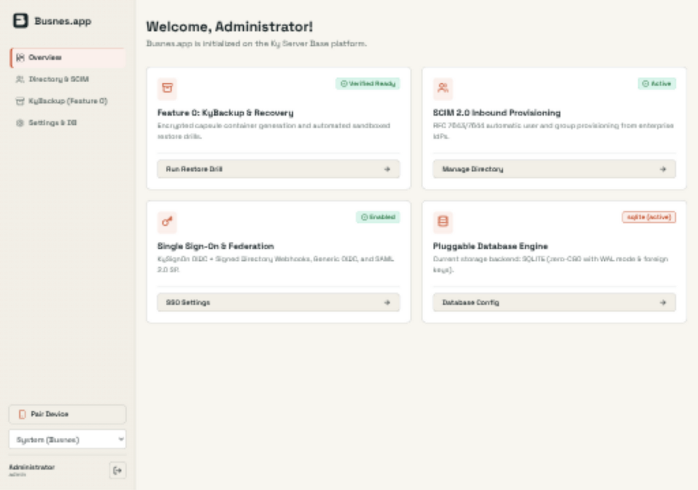
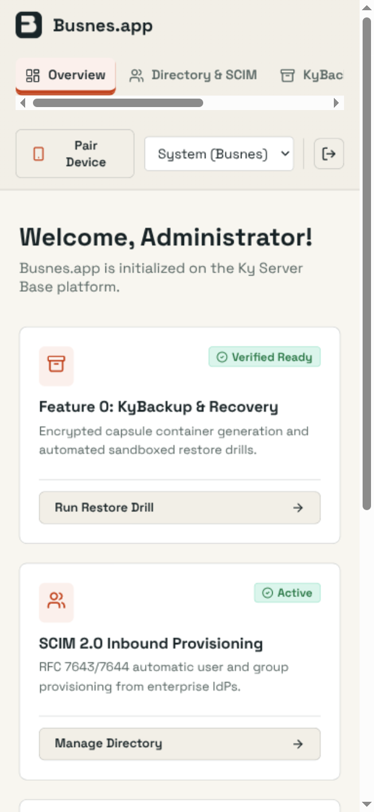

# Shared UI verification

## Change

Include the base as a required consumer so future products inherit verified shared assets. Shared assets are pinned to ky-ui 0.2.0 with content hashes. Product layouts, saved theme keys and named presets remain local.

## Capture conditions

Captured 2026-09-25 from this branch, using the application UI (not a design mockup). Overview in a real scratch server using scaffold defaults.

OS-following Busnes Light and Dark were captured at 1280×900 and 390×844 CSS pixels. Browser device scaling may make PNG dimensions larger. Document width stayed within the viewport in these captured states; local navigation/table scrolling is intentional. Screenshots show the selected-page accent, not a complete accessibility audit.

The subsequent browser-regression change moves worker registration into the JS bundle; production CSP is unchanged. Activation now passes against the real server. HTML refreshes online, and caching excludes dynamic/auth routes.

## Checks

7 frontend tests and production build passed. Central ky-ui sync --check verified all ten consumers. Screenshot coverage is Busnes Light/Dark; existing named choices are retained, but not every named palette/page combination was visually exercised.

## Screenshots

| Light | Dark |
| --- | --- |
|  |  |
|  |  |

## Reproduce

### Automated regression coverage

`web/browser/ui.spec.mjs` runs against a freshly built Go server with disposable SQLite data, real login and production CSP at 390×900 and 1280×900 in both OS themes. CI retains screenshots and failure traces for seven days and requires the browser job before publishing.

The assertions cover worker activation and stale-shell refresh, invalid-login errors, theme persistence and cross-tab/OS transitions, Paper-to-Busnes switching, selected navigation/focus, Settings overflow, and pairing dialog containment/Escape/focus return. The tests exposed and fixed the old 480px minimum Settings column and non-modal pairing behavior. These are workflow checks, not all-page E2E or full accessibility coverage.

Representative captures from the automated run (2026-09-25; scratch pairing codes expire and the server is deleted afterward):

| Mobile Settings — light | Mobile pairing — dark |
| --- | --- |
|  |  |

Build the frontend, then run `go build -o .browser/server ./cmd/server` from the repo root and `cd web && npx playwright install chromium && npm run test:browser`.

### Manual inspection

Run npm ci, npm test (where configured), and npm run build in web/, then start the product with isolated local preview data following its README. Use System theme, emulate OS light/dark, and inspect both viewport sizes. Do not point preview instances at production data. For KyVault, use a configured development KyIdentity or explicitly labeled read-only browser fixtures; never bypass backend authentication.

## 2026-10-26 fleet Appearance

ky-ui 0.4.0 (shared source `4f83f34`): the Appearance theme-card picker over the shared catalog, plus shell geometry from shared tokens. Before/after screenshots, capture conditions, hashes, real-browser behaviour checks and the results spreadsheet are in [docs/ui-fleet-2026-10-26](docs/ui-fleet-2026-10-26/README.md). Ratings are set by the independent council, not this record.

### Review F1: status contrast

All six newly available light palettes now tint error/success toward their own ink. The five original base palettes keep their status values. The real production-server browser test failed in all four OS/width projects before the fix (error contrast 3.29:1 on Light Matter), and passes in all four afterward; the minimum measured status contrast is 7.70:1 across both surfaces. `docs/ui-fleet-2026-10-26/f1-before/` and `f1-after/` preserve matching Sky Appearance captures, per-project ratios, source patch and exact capture conditions (mobile regression viewport390x900). Frontend unit tests and typecheck/build passed. Earlier backend checks remain applicable to unchanged Go source; current-head CI is required after pushing. DOX: updated web/AGENTS.md with the status-color contract; parent ownership/index unchanged.

### Review F7: filled danger button label

The F1 tint darkened the filled danger fill on light suite palettes, whose dark `--button-text` label then read at 1.18–1.68:1 on all six (diagnostic button, hover included). Base defines `.btn-danger` but renders none; products built from Base inherit it. For the 15 suite palettes only (the F1 qualifier), `.btn-danger` now labels with `--bg`. `browser/danger-button.spec.mjs` adds a button labelled "F7 diagnostic: .btn-danger (class unused in Base)" to the real signed-in Overview, under the real CSS and CSP. It measures screenshot pixels in OS light and dark at 1280px, at rest, on hover (opacity 0.9) and on focus, across all 15 palettes. It also asserts that Busnes and the five base palettes keep `--button-text`. It failed before the fix and passes after, with a minimum of 5.83:1 at rest and on focus and 4.97:1 on hover (Dark Matter). Diagnostic captures are stages 05 and 06 in [docs/ui-fleet-2026-10-26](docs/ui-fleet-2026-10-26/README.md); the diagnostic button is not a Base control.
